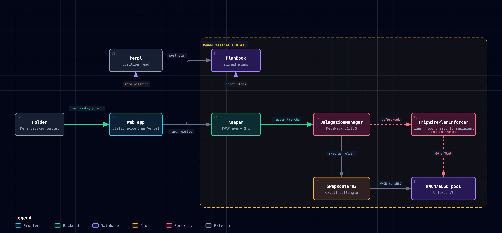

# tripwire

Let a bot sell for you. The chain makes sure it can only make the sale you signed.

A MON holder signs one plan with a passkey: sell this much if MON falls to my line, never under this floor, only to me, until this date. A keeper watches the pool's 60 second TWAP and makes the sale when the line is crossed. Tokens stay in the holder's own wallet until then. The keeper is untrusted by design: `TripwirePlanEnforcer` reverts any sale above the stop line, under the floor, for a different amount, to anyone but the holder, or after expiry. The live site's Try to cheat button has the keeper send exactly those sales, and every one reverts on chain.

Live on Monad testnet: https://tripwire-three.vercel.app



[Open the interactive diagram](docs/architecture.html)

## The 90-second loop

1. Open the site. The first screen shows the keeper's heartbeat, the pool's 60 second average, mainnet spot, and the Perpl position line 1 hedges (account 5429, market 10, long 5753 MON lots).
2. Pick a preset (-5%, -10%, -20%) or open a plan link such as `?sell=0.02@up0.03/0.028`. Each row is a line and a floor in aUSD per MON.
3. Create a passkey wallet. No extension, no seed phrase. Press Get 0.1 testnet MON.
4. Press Sign plan. One passkey prompt wraps the planned MON, upgrades the address through EIP-7702, signs the delegation and posts it to PlanBook.
5. Watch the keeper. A row whose line is crossed sells once, to your address, at or above its floor, and the sale links to its transaction. A row that is not crossed stays unsold.
6. Press Try to cheat. The keeper sends a sale your plan forbids (too early, under the floor, to itself), the enforcer reverts it, and the Watch tab shows the reason read from the mined transaction.
7. Revoke any time, then turn WMON back into MON.

## How it works

The plan is one MetaMask delegation (DelegationManager v1.3.0, deployed on Monad) from the holder to the keeper, with two caveats:

1. `TripwirePlanEnforcer` (contracts/src/TripwirePlanEnforcer.sol), carrying the plan as its terms: router, pool, WMON, stablecoin, fee, TWAP window, recipient, the Perpl account, market and position size the plan hedges, and up to 16 tranches `(lineTick, amountIn, minOutPerUnit, atOrAbove)`. Before every redemption it checks that the call is the router's `exactInputSingle` WMON to stablecoin swap, that the recipient is the holder, that the amount is exactly the tranche's, that the minimum out pays at least the floor, and that the pool's TWAP, oriented as MON's price, is at or below the line for a stop (`Tripwire:above-line` otherwise) or at or above it for a target (`Tripwire:below-line` otherwise). Each tranche fills once per delegation hash, and only the DelegationManager may call the hook.
2. MetaMask's `TimestampEnforcer`, with the plan's end date.

The holder's address becomes MetaMask's stateless DeleGator through EIP-7702, so MON stays at the holder's own address until a sale. A Category Labs Mera passkey is the wallet. `PlanBook` (contracts/src/PlanBook.sol) publishes signed plans so any keeper can find them.

The keeper (keeper/keeper.ts) indexes PlanBook and fills, reads the TWAP every two seconds, and redeems a tranche only after Monad's own gas estimate says the chain will accept it. It serves the web app's read API from memory and, on request, turns hostile on purpose so the holder can watch the contract refuse a forbidden sale.

The web app (web/) is a static export with zero serverless functions. Vercel's CDN rewrites `/api/*` to the keeper. It reads the hedged Perpl position from Perpl's exchange contract on Monad mainnet.

## Built for Monad

- Plans sell WMON, not native MON. Monad's reserve balance rule stops a delegated account under 10 MON from spending native value, so setup wraps the planned MON in a plain transaction first and the EIP-7702 transaction that follows moves no MON.
- Gas limits come from Monad's `eth_estimateGas`. A fill costs about 407k gas on Monad testnet against 289k on an Ethereum-priced fork, and Monad charges the full limit.
- Testnet has no Uniswap V3 deployment, so the factory and SwapRouter02 are deployed from Uniswap's published npm artifacts (the router's pool init-code hash matches the published pool bytecode) with a WMON/aUSD pool. The same enforcer and keeper point at Monad mainnet's WMON/USDC pool by address.

## Contracts on Monad testnet (chain 10143)

Read from contracts/deployments/10143.json and confirmed with `cast code` against https://testnet-rpc.monad.xyz.

| Contract | Address |
|---|---|
| TripwirePlanEnforcer (current) | `0xc603753555255ca5bcde5361625a1a130201df80` |
| PlanBook (current) | `0xb57a6f17261579455ff4869e729c9e74f1753382` |
| WMON/aUSD pool (Uniswap V3, 0.3%) | `0x75E6B52BF8AEFFa56908b6C565944Db9D4C638F5` |
| SwapRouter02 | `0x13c320c4488d4e18ea85e11c46b0d6d29a335e96` |
| WMON | `0x4c594690108f808d9e5603df548740b22e82703e` |
| Uniswap V3 factory | `0xa3157a5a011404a70c033834a19826a9628e6928` |

Earlier enforcer and PlanBook pairs (`0xc66cc7b7...` / `0x6a1fcb21...`, `0x9643f0ab...` / `0xdd26f523...`, `0x754ef1eb...` / `0x30ee5d42...`) stay readable and fillable, so every plan signed against them still shows its sales and refusals.

## Proof

| Claim | Proof |
|---|---|
| The enforcer holds under a hostile keeper | `cd contracts && forge test --fork-url https://rpc1.monad.xyz --fork-block-number 109704919 --fork-retries 12 --fork-retry-backoff 2000`: 19 tests against a Monad mainnet fork with the real DelegationManager, SwapRouter02 and WMON/USDC pool, including 6 fuzz properties at 512 runs each (never other than the tranche amount, never below the floor, never to anyone else, a stop only at or below its line, a target only at or above its line, never more than the plan). Re-run on 2026-10-13: 19 passed, 0 failed. |
| Each guard is load-bearing | Deleting any one guard turns its tests red: logs in contracts/results/ (`mutant-above-line.txt`, `mutant-amount.txt`, `mutant-min-out.txt`, `mutant-recipient.txt`, `mutant-spent.txt`, `mutant-target-as-stop.txt`, `mutant-target-check.txt`, `mutant-value.txt`) |
| The keeper sells a crossed line | tx `0xc80cd805f0e1f88e743609d891a991ed9e68bdd1bd81a246ff4568049999aadf`, status success at block 67518777 |
| A target sells at or above its line | plan 9 sold at a 60 s average of 0.03300 against its 0.03234 target. The keeper's early try on an unreached target reverted `Tripwire:below-line`: `0x22dc276807f75419a5a60248c353127be0ea4b22b3b2e021d9df1cde577646ed` (status failed) |
| Refused on chain, reasons read from the mined transactions | `Tripwire:above-line` `0x819043c97c4c814482cf23858bbfd88d76a697d0c75369ea39b028be9aef1bf5`, `Tripwire:min-out` `0x5053789a5c74addef0a92d3ff7e166d53dee0a457d0993d76dddb19ec4ac2c82`, `Tripwire:recipient` `0xa962ac8e8e8b9cbc5fb31db42f75835fc975b3dedbd40b7866b337600ebab478` (all status failed) |
| Full lifecycle on the current contracts | holder `0xd661b663c2E9fC4F7a07563dE9Fb97Ca345fB05d`: setup `0xdfc2783a3924c0b1c31598e0e1a1f158c42e074c881382632c43686c491cf026`, keeper fill `0x651e1ffa620c6c876483bd4768d4e2fdb4c24955b011c4f4dab83195ea67df6d` (sold exactly 0.005 WMON, status success at block 69245479), an uncrossed stop left unspent for 50.6 s, then revoke `0xc5814914c81965f0ac524798f9f0983e7d5ae80254a540d2af8a26b39c5fa2de`. Evidence in demo/runs/lifecycle-10143-2026-10-08T11-42-02-641Z.json |
| Eighteen holder flows click-tested on the live site | passkey, plan from a link, presets, custom end date, keeper sale, three refused cheats, revoke, unwrap, returning sign-in, keeper heartbeat, at 1440 and 390 px. Listed in docs/feature-matrix.md, logged in demo/runs/ |
| Any holder's plan reads back from chain | `bun run demo/verify-live.ts <holder> --attack` |
| The live keeper is running | `curl -s https://tripwire-three.vercel.app/api/status` returns `loopError: null`, the pool's TWAP and mainnet spot. `curl -s https://tripwire-three.vercel.app/api/recent` returns the plans with their sales and refusals; on 2026-10-13 it listed 26 plans, 23 sales, 35 forbidden sales sent and 35 reverted, 0 paid out |

## Run it

```
# contracts: tests against a Monad mainnet fork
cd contracts && forge test --fork-url https://rpc1.monad.xyz --fork-block-number 109704919 --fork-retries 12 --fork-retry-backoff 2000

# web: static export; the keeper API is same-origin in production, set NEXT_PUBLIC_KEEPER_API for local use
cd web && bun install && bun test lib && NEXT_PUBLIC_KEEPER_API=https://<keeper-host> bunx next build

# keeper: needs a funded testnet key in ~/.config/tripwire/keeper.json ({"keeper":"0x..."})
cd web && bun install && cd .. && bun run keeper/keeper.ts

# prove any holder's plan from chain, and replay the hostile calls
bun run demo/verify-live.ts <holder> --attack
```

`scripts/build-static.sh` builds the zero-function Vercel bundle with the `/api` rewrite to the keeper.

## Layout

- `contracts/` Solidity (TripwirePlanEnforcer, PlanBook, PoolSeeder, WMON), forge tests, mutation logs, `deployments/10143.json`
- `keeper/` the keeper loop and its launchd unit
- `web/` Next.js static export: ticket, chart, Watch tab, passkey wallet, Perpl position read
- `demo/` live proofs: `verify-live.ts`, lifecycle and hostile runs, run logs
- `docs/` feature matrix, architecture diagram, try-it steps
- `scripts/` static build
